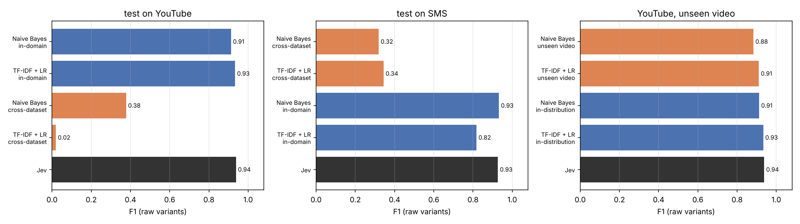

# Generalization under distribution shift

Same test messages for every row. Calibrated rows: mean over 10 seeds. Coverage threshold set on unlabeled target-domain messages.

## G1 cross-dataset: test on youtube

| Train on | Setting | Model | F1 | Brier | ECE | Coverage @5% | Realized risk |
|---|---|---|---|---|---|---|---|
| youtube | in-domain | Naive Bayes (raw) | 0.913 | 0.068 | 0.057 | 1.000 | 0.092 |
| youtube | in-domain | Naive Bayes (calibrated) | 0.925 | 0.059 | 0.031 | 0.983 | 0.066 |
| youtube | in-domain | TF-IDF + LR (raw) | 0.934 | 0.078 | 0.144 | 0.244 | 0.000 |
| youtube | in-domain | TF-IDF + LR (calibrated) | 0.925 | 0.055 | 0.029 | 0.945 | 0.055 |
| sms | cross-dataset | Naive Bayes (raw) | 0.378 | 0.393 | 0.385 | 0.985 | 0.400 |
| sms | cross-dataset | Naive Bayes (calibrated) | 0.196 | 0.399 | 0.394 | 0.880 | 0.451 |
| sms | cross-dataset | TF-IDF + LR (raw) | 0.020 | 0.383 | 0.399 | 0.245 | 0.299 |
| sms | cross-dataset | TF-IDF + LR (calibrated) | 0.179 | 0.403 | 0.428 | 0.974 | 0.465 |
| - | zero-shot | Jev (zero-shot) | 0.938 [0.917, 0.956] | 0.051 | 0.073 | 0.876 | 0.039 |

## G1 cross-dataset: test on sms

| Train on | Setting | Model | F1 | Brier | ECE | Coverage @5% | Realized risk |
|---|---|---|---|---|---|---|---|
| youtube | cross-dataset | Naive Bayes (raw) | 0.319 | 0.403 | 0.474 | 0.648 | 0.519 |
| youtube | cross-dataset | Naive Bayes (calibrated) | 0.371 | 0.221 | 0.275 | 0.342 | 0.239 |
| youtube | cross-dataset | TF-IDF + LR (raw) | 0.344 | 0.213 | 0.324 | 0.000 | 0.000 |
| youtube | cross-dataset | TF-IDF + LR (calibrated) | 0.337 | 0.200 | 0.253 | 0.121 | 0.203 |
| sms | in-domain | Naive Bayes (raw) | 0.932 | 0.015 | 0.009 | 1.000 | 0.017 |
| sms | in-domain | Naive Bayes (calibrated) | 0.923 | 0.016 | 0.009 | 1.000 | 0.019 |
| sms | in-domain | TF-IDF + LR (raw) | 0.818 | 0.035 | 0.087 | 0.504 | 0.000 |
| sms | in-domain | TF-IDF + LR (calibrated) | 0.919 | 0.016 | 0.007 | 1.000 | 0.021 |
| - | zero-shot | Jev (zero-shot) | 0.927 [0.903, 0.949] | 0.014 | 0.032 | 1.000 | 0.020 |

## G2 leave-one-video-out (YouTube), F1 of raw variants

| Video | Naive Bayes in-dist → unseen | TF-IDF + LR in-dist → unseen | Jev |
|---|---|---|---|
| Eminem | 0.929 → 0.906 (-0.023) | 0.946 → 0.928 (-0.018) | 0.952 [0.914, 0.986] |
| KatyPerry | 0.900 → 0.911 (+0.011) | 0.939 → 0.928 (-0.011) | 0.948 [0.898, 0.989] |
| LMFAO | 0.942 → 0.926 (-0.017) | 0.957 → 0.940 (-0.017) | 0.919 [0.857, 0.963] |
| Psy | 0.871 → 0.833 (-0.038) | 0.936 → 0.880 (-0.056) | 0.978 [0.945, 1.000] |
| Shakira | 0.908 → 0.841 (-0.066) | 0.892 → 0.875 (-0.017) | 0.904 [0.848, 0.951] |
| all videos | 0.913 → 0.883 (-0.029) | 0.934 → 0.911 (-0.023) | 0.938 [0.917, 0.956] |

## G2 all videos pooled

| Train on | Setting | Model | F1 | Brier | ECE | Coverage @5% | Realized risk |
|---|---|---|---|---|---|---|---|
| other videos | unseen video | Naive Bayes (raw) | 0.883 | 0.096 | 0.095 | 0.937 | 0.095 |
| other videos | unseen video | TF-IDF + LR (raw) | 0.911 | 0.091 | 0.138 | 0.206 | 0.000 |
| pool | in-distribution | Naive Bayes (raw) | 0.913 | 0.068 | 0.057 | 1.000 | 0.092 |
| pool | in-distribution | Naive Bayes (calibrated) | 0.925 | 0.059 | 0.031 | 0.983 | 0.066 |
| pool | in-distribution | TF-IDF + LR (raw) | 0.934 | 0.078 | 0.144 | 0.244 | 0.000 |
| pool | in-distribution | TF-IDF + LR (calibrated) | 0.925 | 0.055 | 0.029 | 0.945 | 0.055 |
| - | zero-shot | Jev (zero-shot) | 0.938 | 0.051 | 0.073 | 0.876 | 0.039 |

