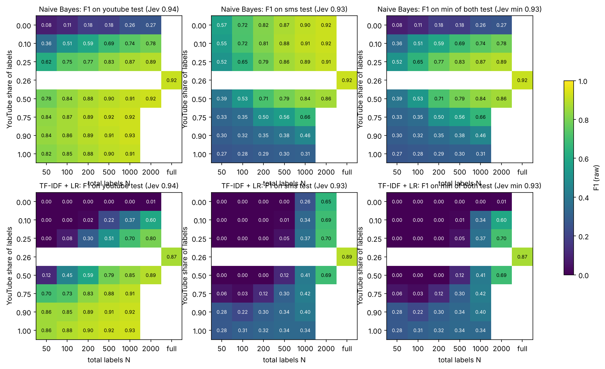

# Mixed-dataset training

Lightweight models trained on a mix of YouTube and SMS labels (YouTube share × total N, mean of 10 draws), tested on each dataset's test set. `full` = both pools combined (YouTube share 0.26). Jev zero-shot F1: YouTube 0.938, SMS 0.927.

## Naive Bayes: F1 on youtube test (raw)

| YouTube share \ N | 50 | 100 | 200 | 500 | 1000 | 2000 | full |
|---|---|---|---|---|---|---|---|
| 0.00 | 0.08 | 0.11 | 0.18 | 0.18 | 0.26 | 0.27 | – |
| 0.10 | 0.36 | 0.51 | 0.59 | 0.69 | 0.74 | 0.78 | – |
| 0.25 | 0.62 | 0.75 | 0.77 | 0.83 | 0.87 | 0.89 | – |
| 0.26 | – | – | – | – | – | – | 0.92 |
| 0.50 | 0.78 | 0.84 | 0.88 | 0.90 | 0.91 | 0.92 | – |
| 0.75 | 0.84 | 0.87 | 0.89 | 0.92 | 0.92 | – | – |
| 0.90 | 0.84 | 0.86 | 0.89 | 0.91 | 0.93 | – | – |
| 1.00 | 0.82 | 0.85 | 0.88 | 0.90 | 0.91 | – | – |

## Naive Bayes: F1 on sms test (raw)

| YouTube share \ N | 50 | 100 | 200 | 500 | 1000 | 2000 | full |
|---|---|---|---|---|---|---|---|
| 0.00 | 0.57 | 0.72 | 0.82 | 0.87 | 0.90 | 0.92 | – |
| 0.10 | 0.55 | 0.72 | 0.81 | 0.88 | 0.91 | 0.92 | – |
| 0.25 | 0.52 | 0.65 | 0.79 | 0.86 | 0.89 | 0.91 | – |
| 0.26 | – | – | – | – | – | – | 0.92 |
| 0.50 | 0.39 | 0.53 | 0.71 | 0.79 | 0.84 | 0.86 | – |
| 0.75 | 0.33 | 0.35 | 0.50 | 0.56 | 0.66 | – | – |
| 0.90 | 0.30 | 0.32 | 0.35 | 0.38 | 0.46 | – | – |
| 1.00 | 0.27 | 0.28 | 0.29 | 0.30 | 0.31 | – | – |

## Naive Bayes: Brier on each test (calibrated)

youtube:

| YouTube share \ N | 50 | 100 | 200 | 500 | 1000 | 2000 | full |
|---|---|---|---|---|---|---|---|
| 0.00 | 0.450 | 0.430 | 0.425 | 0.420 | 0.408 | 0.404 | – |
| 0.10 | 0.354 | 0.303 | 0.286 | 0.231 | 0.213 | 0.189 | – |
| 0.25 | 0.286 | 0.202 | 0.183 | 0.144 | 0.111 | 0.108 | – |
| 0.26 | – | – | – | – | – | – | 0.086 |
| 0.50 | 0.206 | 0.144 | 0.118 | 0.092 | 0.079 | 0.073 | – |
| 0.75 | 0.159 | 0.125 | 0.096 | 0.071 | 0.066 | – | – |
| 0.90 | 0.153 | 0.104 | 0.083 | 0.069 | 0.064 | – | – |
| 1.00 | 0.133 | 0.100 | 0.087 | 0.069 | 0.062 | – | – |

sms:

| YouTube share \ N | 50 | 100 | 200 | 500 | 1000 | 2000 | full |
|---|---|---|---|---|---|---|---|
| 0.00 | 0.082 | 0.067 | 0.043 | 0.032 | 0.024 | 0.019 | – |
| 0.10 | 0.097 | 0.063 | 0.047 | 0.032 | 0.024 | 0.020 | – |
| 0.25 | 0.111 | 0.080 | 0.055 | 0.034 | 0.026 | 0.021 | – |
| 0.26 | – | – | – | – | – | – | 0.017 |
| 0.50 | 0.125 | 0.104 | 0.070 | 0.047 | 0.034 | 0.027 | – |
| 0.75 | 0.188 | 0.145 | 0.102 | 0.078 | 0.059 | – | – |
| 0.90 | 0.179 | 0.166 | 0.166 | 0.136 | 0.105 | – | – |
| 1.00 | 0.288 | 0.216 | 0.210 | 0.210 | 0.227 | – | – |

## TF-IDF + LR: F1 on youtube test (raw)

| YouTube share \ N | 50 | 100 | 200 | 500 | 1000 | 2000 | full |
|---|---|---|---|---|---|---|---|
| 0.00 | 0.00 | 0.00 | 0.00 | 0.00 | 0.00 | 0.01 | – |
| 0.10 | 0.00 | 0.00 | 0.02 | 0.22 | 0.37 | 0.60 | – |
| 0.25 | 0.00 | 0.08 | 0.30 | 0.51 | 0.70 | 0.80 | – |
| 0.26 | – | – | – | – | – | – | 0.87 |
| 0.50 | 0.12 | 0.45 | 0.59 | 0.79 | 0.85 | 0.89 | – |
| 0.75 | 0.70 | 0.73 | 0.83 | 0.88 | 0.91 | – | – |
| 0.90 | 0.86 | 0.85 | 0.89 | 0.91 | 0.92 | – | – |
| 1.00 | 0.86 | 0.88 | 0.90 | 0.92 | 0.93 | – | – |

## TF-IDF + LR: F1 on sms test (raw)

| YouTube share \ N | 50 | 100 | 200 | 500 | 1000 | 2000 | full |
|---|---|---|---|---|---|---|---|
| 0.00 | 0.00 | 0.00 | 0.00 | 0.00 | 0.26 | 0.65 | – |
| 0.10 | 0.00 | 0.00 | 0.00 | 0.01 | 0.34 | 0.69 | – |
| 0.25 | 0.00 | 0.00 | 0.00 | 0.05 | 0.37 | 0.70 | – |
| 0.26 | – | – | – | – | – | – | 0.89 |
| 0.50 | 0.00 | 0.00 | 0.00 | 0.12 | 0.41 | 0.69 | – |
| 0.75 | 0.06 | 0.03 | 0.12 | 0.30 | 0.42 | – | – |
| 0.90 | 0.28 | 0.22 | 0.30 | 0.34 | 0.40 | – | – |
| 1.00 | 0.28 | 0.31 | 0.32 | 0.34 | 0.34 | – | – |

## TF-IDF + LR: Brier on each test (calibrated)

youtube:

| YouTube share \ N | 50 | 100 | 200 | 500 | 1000 | 2000 | full |
|---|---|---|---|---|---|---|---|
| 0.00 | 0.412 | 0.417 | 0.393 | 0.405 | 0.400 | 0.414 | – |
| 0.10 | 0.411 | 0.354 | 0.290 | 0.176 | 0.129 | 0.108 | – |
| 0.25 | 0.324 | 0.285 | 0.183 | 0.103 | 0.081 | 0.069 | – |
| 0.26 | – | – | – | – | – | – | 0.057 |
| 0.50 | 0.256 | 0.199 | 0.133 | 0.081 | 0.062 | 0.054 | – |
| 0.75 | 0.215 | 0.164 | 0.110 | 0.069 | 0.061 | – | – |
| 0.90 | 0.214 | 0.148 | 0.102 | 0.069 | 0.059 | – | – |
| 1.00 | 0.202 | 0.138 | 0.097 | 0.065 | 0.057 | – | – |

sms:

| YouTube share \ N | 50 | 100 | 200 | 500 | 1000 | 2000 | full |
|---|---|---|---|---|---|---|---|
| 0.00 | 0.116 | 0.112 | 0.084 | 0.037 | 0.023 | 0.018 | – |
| 0.10 | 0.116 | 0.109 | 0.087 | 0.039 | 0.024 | 0.020 | – |
| 0.25 | 0.121 | 0.111 | 0.086 | 0.047 | 0.031 | 0.023 | – |
| 0.26 | – | – | – | – | – | – | 0.019 |
| 0.50 | 0.147 | 0.118 | 0.100 | 0.065 | 0.049 | 0.036 | – |
| 0.75 | 0.191 | 0.145 | 0.122 | 0.098 | 0.080 | – | – |
| 0.90 | 0.197 | 0.174 | 0.156 | 0.130 | 0.122 | – | – |
| 1.00 | 0.260 | 0.211 | 0.181 | 0.184 | 0.198 | – | – |

## Does the other dataset help? Mixed minus target-only part (F1, raw)

Positive = adding the other dataset's labels helped on this test set.

Naive Bayes, youtube test:

| YouTube share \ N | 50 | 100 | 200 | 500 | 1000 | 2000 | full |
|---|---|---|---|---|---|---|---|
| 0.10 | -0.259 | -0.165 | -0.170 | -0.139 | -0.114 | -0.089 | – |
| 0.25 | -0.100 | -0.048 | -0.042 | -0.016 | -0.002 | -0.009 | – |
| 0.26 | – | – | – | – | – | – | 0.003 |
| 0.50 | -0.002 | 0.025 | 0.032 | 0.014 | 0.014 | 0.015 | – |
| 0.75 | 0.036 | 0.039 | 0.029 | 0.024 | 0.016 | – | – |
| 0.90 | 0.028 | 0.027 | 0.022 | 0.018 | 0.016 | – | – |

Naive Bayes, sms test:

| YouTube share \ N | 50 | 100 | 200 | 500 | 1000 | 2000 | full |
|---|---|---|---|---|---|---|---|
| 0.10 | 0.018 | 0.025 | 0.024 | 0.003 | 0.006 | 0.002 | – |
| 0.25 | 0.021 | 0.025 | 0.004 | 0.009 | 0.002 | -0.004 | – |
| 0.26 | – | – | – | – | – | – | -0.011 |
| 0.50 | -0.012 | -0.057 | 0.015 | -0.053 | -0.034 | -0.044 | – |
| 0.75 | -0.051 | -0.021 | -0.084 | -0.213 | -0.173 | – | – |
| 0.90 | 0.009 | 0.071 | -0.147 | -0.244 | -0.247 | – | – |

TF-IDF + LR, youtube test:

| YouTube share \ N | 50 | 100 | 200 | 500 | 1000 | 2000 | full |
|---|---|---|---|---|---|---|---|
| 0.10 | -0.680 | -0.757 | -0.775 | -0.629 | -0.513 | -0.313 | – |
| 0.25 | -0.773 | -0.730 | -0.551 | -0.382 | -0.203 | -0.120 | – |
| 0.26 | – | – | – | – | – | – | -0.064 |
| 0.50 | -0.677 | -0.411 | -0.295 | -0.123 | -0.076 | -0.039 | – |
| 0.75 | -0.113 | -0.140 | -0.073 | -0.030 | -0.020 | – | – |
| 0.90 | -0.000 | -0.025 | -0.010 | -0.006 | -0.005 | – | – |

TF-IDF + LR, sms test:

| YouTube share \ N | 50 | 100 | 200 | 500 | 1000 | 2000 | full |
|---|---|---|---|---|---|---|---|
| 0.10 | 0.000 | 0.000 | 0.000 | 0.013 | 0.162 | 0.074 | – |
| 0.25 | 0.000 | 0.000 | 0.000 | 0.046 | 0.314 | 0.183 | – |
| 0.26 | – | – | – | – | – | – | 0.074 |
| 0.50 | 0.000 | 0.000 | 0.004 | 0.117 | 0.407 | 0.429 | – |
| 0.75 | 0.055 | 0.029 | 0.117 | 0.305 | 0.423 | – | – |
| 0.90 | 0.276 | 0.220 | 0.304 | 0.340 | 0.399 | – | – |

## Best mix per total (by the lower of the two F1s, raw)

| Model | N | Best YouTube share | F1 YouTube | F1 SMS | Within Jev's interval on both? |
|---|---|---|---|---|---|
| Naive Bayes | 50 | 0.25 | 0.620 | 0.516 | no |
| Naive Bayes | 100 | 0.25 | 0.748 | 0.650 | no |
| Naive Bayes | 200 | 0.25 | 0.769 | 0.785 | no |
| Naive Bayes | 500 | 0.25 | 0.835 | 0.860 | no |
| Naive Bayes | 1000 | 0.25 | 0.873 | 0.890 | no |
| Naive Bayes | 2000 | 0.25 | 0.887 | 0.911 | no |
| Naive Bayes | full | 0.26 | 0.916 | 0.922 | no |
| TF-IDF + LR | 50 | 1.00 | 0.856 | 0.280 | no |
| TF-IDF + LR | 100 | 1.00 | 0.884 | 0.307 | no |
| TF-IDF + LR | 200 | 1.00 | 0.904 | 0.324 | no |
| TF-IDF + LR | 500 | 1.00 | 0.920 | 0.341 | no |
| TF-IDF + LR | 1000 | 0.75 | 0.906 | 0.423 | no |
| TF-IDF + LR | 2000 | 0.25 | 0.796 | 0.704 | no |
| TF-IDF + LR | full | 0.26 | 0.869 | 0.892 | no |

