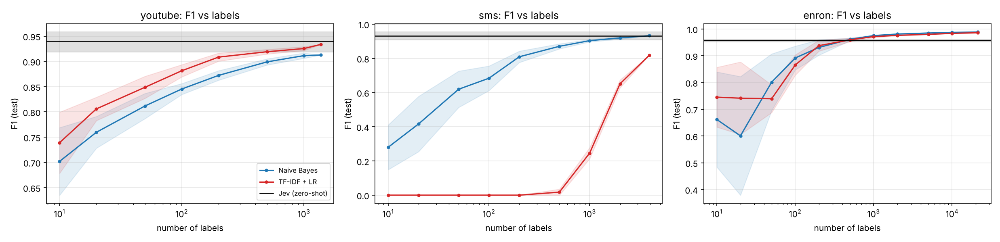
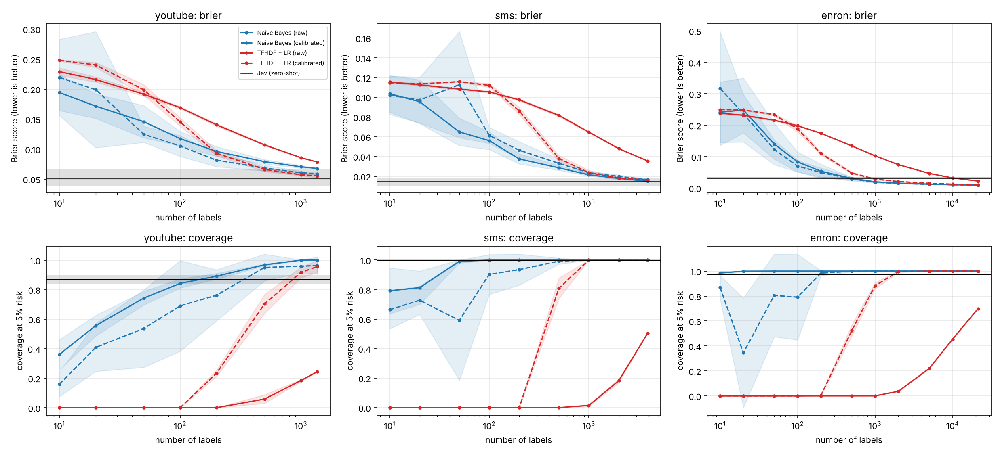
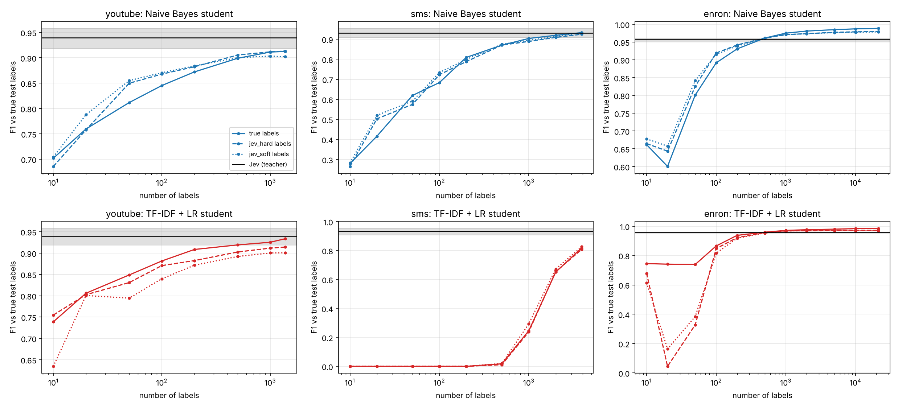

# Pilot results: Jev vs lightweight models on spam filtering

## Jev zero-shot (test set, main rubric)

| Dataset | F1 | Brier | ECE | Coverage @5% | Realized risk | Model string |
|---|---|---|---|---|---|---|
| youtube | 0.940 [0.918, 0.958] | 0.052 [0.040, 0.065] | 0.066 | 0.871 | 0.035 | jev-1.13.0 |
| sms | 0.931 [0.908, 0.954] | 0.015 [0.011, 0.018] | 0.032 | 0.999 | 0.018 | jev-1.13.0 |
| enron | 0.957 [0.952, 0.961] | 0.032 [0.030, 0.035] | 0.021 | 0.973 | 0.031 | jev-1.13.0 |

## Baselines at full pool (true labels, mean ± sd over 10 seeds)

| Dataset | Model | Variant | n | F1 | Brier | ECE | Coverage @5% | Realized risk |
|---|---|---|---|---|---|---|---|---|
| youtube | Naive Bayes | raw | 1369 | 0.913 ± 0.000 | 0.068 | 0.057 | 1.000 | 0.092 |
| youtube | Naive Bayes | calibrated | 1369 | 0.925 ± 0.004 | 0.059 | 0.036 | 0.963 | 0.063 |
| youtube | TF-IDF + LR | raw | 1369 | 0.934 ± 0.000 | 0.078 | 0.144 | 0.244 | 0.000 |
| youtube | TF-IDF + LR | calibrated | 1369 | 0.924 ± 0.007 | 0.055 | 0.030 | 0.957 | 0.059 |
| sms | Naive Bayes | raw | 3901 | 0.932 ± 0.000 | 0.015 | 0.009 | 1.000 | 0.017 |
| sms | Naive Bayes | calibrated | 3901 | 0.922 ± 0.005 | 0.017 | 0.008 | 1.000 | 0.019 |
| sms | TF-IDF + LR | raw | 3901 | 0.818 ± 0.000 | 0.035 | 0.087 | 0.504 | 0.000 |
| sms | TF-IDF + LR | calibrated | 3901 | 0.916 ± 0.003 | 0.016 | 0.007 | 1.000 | 0.021 |
| enron | Naive Bayes | raw | 21322 | 0.988 ± 0.000 | 0.009 | 0.002 | 1.000 | 0.011 |
| enron | Naive Bayes | calibrated | 21322 | 0.989 ± 0.001 | 0.009 | 0.004 | 1.000 | 0.011 |
| enron | TF-IDF + LR | raw | 21322 | 0.986 ± 0.000 | 0.022 | 0.075 | 0.699 | 0.000 |
| enron | TF-IDF + LR | calibrated | 21322 | 0.986 ± 0.000 | 0.010 | 0.003 | 1.000 | 0.013 |

## n*: labels needed to match Jev (E1, E2)

Smallest budget whose mean reaches Jev's bootstrap interval; `>pool` = never reached.

| Dataset | Model | Variant | n* F1 | n* Brier | n* ECE | n* coverage |
|---|---|---|---|---|---|---|
| youtube | Naive Bayes | calibrated | 1000 | 1000 | 200 | 500 |
| youtube | Naive Bayes | raw | >pool | >pool | 500 | 200 |
| youtube | TF-IDF + LR | calibrated | 1000 | 1000 | 500 | 1000 |
| youtube | TF-IDF + LR | raw | 500 | >pool | >pool | >pool |
| sms | Naive Bayes | calibrated | 2000 | 3901 | 500 | 1000 |
| sms | Naive Bayes | raw | 2000 | 2000 | 200 | 100 |
| sms | TF-IDF + LR | calibrated | 2000 | 2000 | 1000 | 1000 |
| sms | TF-IDF + LR | raw | >pool | >pool | >pool | >pool |
| enron | Naive Bayes | calibrated | 500 | 500 | 500 | 200 |
| enron | Naive Bayes | raw | 500 | 500 | 1000 | 10 |
| enron | TF-IDF + LR | calibrated | 500 | 1000 | 2000 | 2000 |
| enron | TF-IDF + LR | raw | 500 | 10000 | >pool | >pool |

## E3: Jev as teacher

| Dataset | Model | Label source | n* F1 (vs Jev) | Best mean F1 | Exceeds Jev? |
|---|---|---|---|---|---|
| youtube | Naive Bayes | true | >pool | 0.913 | no |
| youtube | TF-IDF + LR | true | 500 | 0.934 | no |
| youtube | Naive Bayes | jev_hard | >pool | 0.913 | no |
| youtube | TF-IDF + LR | jev_hard | >pool | 0.914 | no |
| youtube | Naive Bayes | jev_soft | >pool | 0.904 | no |
| youtube | TF-IDF + LR | jev_soft | >pool | 0.901 | no |
| sms | Naive Bayes | true | 2000 | 0.932 | yes |
| sms | TF-IDF + LR | true | >pool | 0.818 | no |
| sms | Naive Bayes | jev_hard | 2000 | 0.924 | no |
| sms | TF-IDF + LR | jev_hard | >pool | 0.807 | no |
| sms | Naive Bayes | jev_soft | 2000 | 0.932 | yes |
| sms | TF-IDF + LR | jev_soft | >pool | 0.826 | no |
| enron | Naive Bayes | true | 500 | 0.988 | yes |
| enron | TF-IDF + LR | true | 500 | 0.986 | yes |
| enron | Naive Bayes | jev_hard | 500 | 0.980 | yes |
| enron | TF-IDF + LR | jev_hard | 500 | 0.972 | yes |
| enron | Naive Bayes | jev_soft | 500 | 0.979 | yes |
| enron | TF-IDF + LR | jev_soft | 500 | 0.971 | yes |

## E4: latency and cost per 1,000 decisions

| Dataset | Model | Median ms | p95 ms | US$ / 1,000 |
|---|---|---|---|---|
| youtube | Jev (client-side) | 101.9 | 224.1 | 0.016296 |
| youtube | Naive Bayes (CPU) | 0.37 | 0.67 | ~0 |
| youtube | TF-IDF + LR (CPU) | 0.65 | 1.38 | ~0 |
| sms | Jev (client-side) | 100.0 | 215.4 | 0.015861 |
| sms | Naive Bayes (CPU) | 0.39 | 0.67 | ~0 |
| sms | TF-IDF + LR (CPU) | 0.67 | 1.42 | ~0 |
| enron | Jev (client-side) | 96.7 | 161.4 | 0.028803 |
| enron | Naive Bayes (CPU) | 1.39 | 2.61 | ~0 |
| enron | TF-IDF + LR (CPU) | 1.00 | 1.93 | ~0 |

## Checks

- **Wording sensitivity (youtube):** alt rubric F1 0.935 vs main 0.940; Brier 0.056 vs 0.052.
- **Stability (youtube):** pending (run `jev_run.py --stability --run-tag day2` on a second day).
- **Wording sensitivity (sms):** alt rubric F1 0.931 vs main 0.931; Brier 0.014 vs 0.015.
- **Stability (sms):** pending (run `jev_run.py --stability --run-tag day2` on a second day).
- **Wording sensitivity (enron):** alt rubric F1 0.946 vs main 0.957; Brier 0.039 vs 0.032.
- **Stability (enron):** pending (run `jev_run.py --stability --run-tag day2` on a second day).
- **Contamination:** Jev F1 minus best full-pool baseline F1: youtube +0.006, sms -0.001, enron -0.032. A gap well above zero on one dataset but not the others would suggest exposure, not skill.

## Figures

## Notes

- Coverage @5% risk: each model automates messages whose confidence max(p, 1−p) clears a threshold chosen on its own (unlabeled) training-pool predictions so that its expected error is ≤ 5%. Realized risk is the actual error rate among automated test messages.
- Calibrated variants fit on 80% of the sample and fit Platt scaling on the other 20%; when that 20% lacks a class (small n) Platt scaling is skipped.
- Baselines: mean over 10 stratified draws per budget. Jev: bootstrap 95% intervals over test messages.
