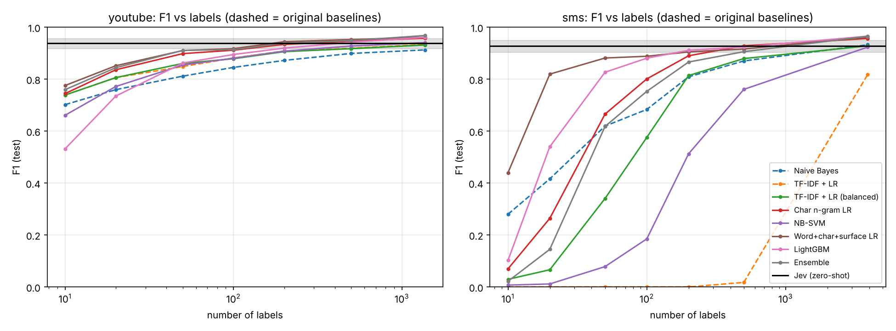
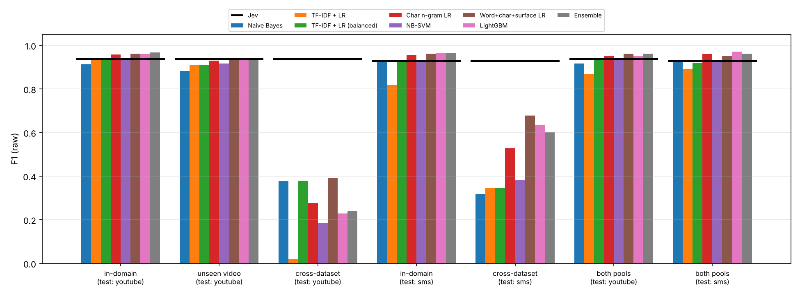

# Stronger classic models vs Jev

Non-pretrained models with configurations fixed in advance (no tuning on test data). Original baselines: Naive Bayes, TF-IDF + LR. Curves: mean of 10 draws.

## youtube: F1 vs labels (raw); Jev 0.938 [0.917, 0.956]

| Model | 10 | 20 | 50 | 100 | 200 | 500 | full | n* to match Jev | n to beat Jev's upper bound |
|---|---|---|---|---|---|---|---|---|---|
| Naive Bayes | 0.702 | 0.760 | 0.812 | 0.845 | 0.872 | 0.899 | 0.913 | >pool | – |
| TF-IDF + LR | 0.739 | 0.806 | 0.849 | 0.881 | 0.909 | 0.919 | 0.934 | 500 | – |
| TF-IDF + LR (balanced) | 0.739 | 0.806 | 0.861 | 0.879 | 0.906 | 0.917 | 0.932 | 500 | – |
| Char n-gram LR | 0.745 | 0.836 | 0.898 | 0.911 | 0.934 | 0.946 | 0.958 | 200 | 1369 |
| NB-SVM | 0.661 | 0.772 | 0.855 | 0.881 | 0.908 | 0.928 | 0.941 | 500 | – |
| Word+char+surface LR | 0.776 | 0.852 | 0.910 | 0.917 | 0.944 | 0.953 | 0.961 | 100 | 1369 |
| LightGBM | 0.532 | 0.735 | 0.862 | 0.895 | 0.920 | 0.942 | 0.961 | 200 | 1369 |
| Ensemble | 0.760 | 0.844 | 0.911 | 0.914 | 0.939 | 0.949 | 0.968 | 200 | 1369 |

## sms: F1 vs labels (raw); Jev 0.927 [0.903, 0.949]

| Model | 10 | 20 | 50 | 100 | 200 | 500 | full | n* to match Jev | n to beat Jev's upper bound |
|---|---|---|---|---|---|---|---|---|---|
| Naive Bayes | 0.280 | 0.416 | 0.619 | 0.684 | 0.809 | 0.870 | 0.932 | 3901 | – |
| TF-IDF + LR | 0.000 | 0.000 | 0.000 | 0.000 | 0.000 | 0.018 | 0.818 | >pool | – |
| TF-IDF + LR (balanced) | 0.029 | 0.066 | 0.340 | 0.576 | 0.814 | 0.879 | 0.928 | 3901 | – |
| Char n-gram LR | 0.070 | 0.264 | 0.665 | 0.801 | 0.890 | 0.928 | 0.957 | 500 | 3901 |
| NB-SVM | 0.007 | 0.011 | 0.078 | 0.185 | 0.513 | 0.761 | 0.923 | 3901 | – |
| Word+char+surface LR | 0.440 | 0.819 | 0.881 | 0.888 | 0.905 | 0.916 | 0.961 | 200 | 3901 |
| LightGBM | 0.102 | 0.540 | 0.827 | 0.881 | 0.911 | 0.924 | 0.966 | 200 | 3901 |
| Ensemble | 0.022 | 0.145 | 0.618 | 0.753 | 0.866 | 0.906 | 0.966 | 500 | 3901 |

## Full pool, all metrics

| Dataset | Model | Variant | F1 | Brier | ECE | Coverage @5% | Realized risk |
|---|---|---|---|---|---|---|---|
| youtube | Jev (zero-shot) | – | 0.938 | 0.051 | 0.073 | 0.876 | 0.039 |
| youtube | Naive Bayes | raw | 0.913 | 0.068 | 0.057 | 1.000 | 0.092 |
| youtube | Naive Bayes | calibrated | 0.925 | 0.059 | 0.036 | 0.964 | 0.063 |
| youtube | TF-IDF + LR | raw | 0.934 | 0.078 | 0.144 | 0.244 | 0.000 |
| youtube | TF-IDF + LR | calibrated | 0.924 | 0.055 | 0.030 | 0.957 | 0.059 |
| youtube | TF-IDF + LR (balanced) | raw | 0.932 | 0.078 | 0.144 | 0.235 | 0.000 |
| youtube | TF-IDF + LR (balanced) | calibrated | 0.924 | 0.055 | 0.030 | 0.956 | 0.059 |
| youtube | Char n-gram LR | raw | 0.958 | 0.033 | 0.039 | 0.988 | 0.036 |
| youtube | Char n-gram LR | calibrated | 0.956 | 0.033 | 0.014 | 0.995 | 0.042 |
| youtube | NB-SVM | raw | 0.941 | 0.042 | 0.022 | 0.995 | 0.057 |
| youtube | NB-SVM | calibrated | 0.940 | 0.046 | 0.029 | 0.997 | 0.058 |
| youtube | Word+char+surface LR | raw | 0.961 | 0.029 | 0.019 | 0.954 | 0.021 |
| youtube | Word+char+surface LR | calibrated | 0.961 | 0.030 | 0.014 | 0.997 | 0.038 |
| youtube | LightGBM | raw | 0.961 | 0.033 | 0.026 | 0.872 | 0.012 |
| youtube | LightGBM | calibrated | 0.956 | 0.033 | 0.018 | 0.991 | 0.041 |
| youtube | Ensemble | raw | 0.968 | 0.029 | 0.033 | 0.974 | 0.024 |
| youtube | Ensemble | calibrated | 0.965 | 0.029 | 0.017 | 0.991 | 0.032 |
| sms | Jev (zero-shot) | – | 0.927 | 0.014 | 0.032 | 1.000 | 0.020 |
| sms | Naive Bayes | raw | 0.932 | 0.015 | 0.009 | 1.000 | 0.017 |
| sms | Naive Bayes | calibrated | 0.922 | 0.017 | 0.008 | 1.000 | 0.019 |
| sms | TF-IDF + LR | raw | 0.818 | 0.035 | 0.087 | 0.504 | 0.000 |
| sms | TF-IDF + LR | calibrated | 0.916 | 0.016 | 0.007 | 1.000 | 0.021 |
| sms | TF-IDF + LR (balanced) | raw | 0.928 | 0.037 | 0.131 | 0.077 | 0.000 |
| sms | TF-IDF + LR (balanced) | calibrated | 0.923 | 0.015 | 0.006 | 1.000 | 0.020 |
| sms | Char n-gram LR | raw | 0.957 | 0.009 | 0.016 | 0.998 | 0.009 |
| sms | Char n-gram LR | calibrated | 0.960 | 0.009 | 0.004 | 0.999 | 0.010 |
| sms | NB-SVM | raw | 0.923 | 0.016 | 0.016 | 0.991 | 0.014 |
| sms | NB-SVM | calibrated | 0.933 | 0.014 | 0.009 | 0.999 | 0.016 |
| sms | Word+char+surface LR | raw | 0.961 | 0.009 | 0.006 | 0.995 | 0.009 |
| sms | Word+char+surface LR | calibrated | 0.957 | 0.009 | 0.005 | 0.999 | 0.011 |
| sms | LightGBM | raw | 0.966 | 0.008 | 0.007 | 0.967 | 0.002 |
| sms | LightGBM | calibrated | 0.969 | 0.007 | 0.004 | 0.999 | 0.008 |
| sms | Ensemble | raw | 0.966 | 0.008 | 0.013 | 0.980 | 0.005 |
| sms | Ensemble | calibrated | 0.967 | 0.007 | 0.004 | 0.998 | 0.008 |

## Distribution shift (F1, raw; calibrated Brier and realized risk in brackets)

| Model | YouTube in-domain | YouTube unseen video | YouTube ← SMS | SMS in-domain | SMS ← YouTube | Both pools → YouTube | Both pools → SMS |
|---|---|---|---|---|---|---|---|
| Naive Bayes | 0.913 [0.059, 0.07] | 0.883 | 0.378 [0.399, 0.45] | 0.932 [0.016, 0.02] | 0.319 [0.221, 0.24] | 0.916 [0.086, 0.07] | 0.922 [0.017, 0.02] |
| TF-IDF + LR | 0.934 [0.055, 0.05] | 0.911 | 0.020 [0.403, 0.46] | 0.818 [0.016, 0.02] | 0.344 [0.200, 0.20] | 0.869 [0.056, 0.07] | 0.892 [0.019, 0.02] |
| TF-IDF + LR (balanced) | 0.932 [0.055, 0.05] | 0.908 | 0.380 [0.400, 0.46] | 0.928 [0.015, 0.02] | 0.346 [0.200, 0.20] | 0.935 [0.055, 0.07] | 0.919 [0.018, 0.02] |
| Char n-gram LR | 0.958 [0.032, 0.04] | 0.930 | 0.276 [0.329, 0.39] | 0.957 [0.009, 0.01] | 0.527 [0.170, 0.11] | 0.953 [0.041, 0.05] | 0.959 [0.010, 0.01] |
| NB-SVM | 0.941 [0.045, 0.06] | 0.917 | 0.186 [0.389, 0.44] | 0.923 [0.013, 0.02] | 0.380 [0.145, 0.12] | 0.934 [0.049, 0.06] | 0.929 [0.017, 0.02] |
| Word+char+surface LR | 0.961 [0.030, 0.04] | 0.943 | 0.391 [0.332, 0.38] | 0.961 [0.009, 0.01] | 0.679 [0.113, 0.06] | 0.961 [0.034, 0.04] | 0.953 [0.011, 0.01] |
| LightGBM | 0.961 [0.033, 0.04] | 0.933 | 0.229 [0.391, 0.43] | 0.966 [0.007, 0.01] | 0.634 [0.120, 0.07] | 0.952 [0.045, 0.05] | 0.970 [0.008, 0.01] |
| Ensemble | 0.968 [0.029, 0.04] | 0.943 | 0.239 [0.313, 0.37] | 0.966 [0.007, 0.01] | 0.601 [0.127, 0.08] | 0.961 [0.034, 0.04] | 0.961 [0.009, 0.01] |
| Jev (zero-shot) | 0.938 | 0.938 | 0.938 | 0.927 | 0.927 | 0.938 | 0.927 |

Jev needs no training labels, so its score is the same in every column of a dataset.

