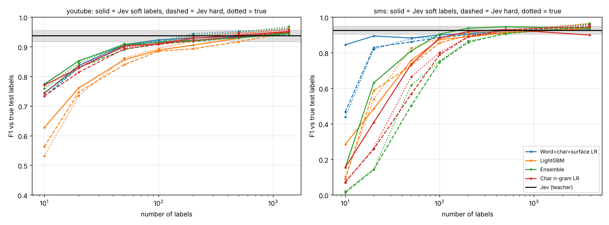

# Jev as teacher for the stronger classic models

Students see no human labels: training targets, Platt calibration and coverage thresholds all come from Jev's labels or unlabeled data. Scores are against true test labels. Curves: mean of 10 draws.

Teacher quality on the training pools: youtube accuracy 0.955 (spam rate true 0.51, Jev 0.48); sms accuracy 0.984 (spam rate true 0.13, Jev 0.14).

## youtube: student F1 (raw); Jev 0.938 [0.917, 0.956]

| Student | Labels | 10 | 20 | 50 | 100 | 200 | 500 | full | n to match Jev | Beats Jev's upper bound? |
|---|---|---|---|---|---|---|---|---|---|---|
| TF-IDF + LR (balanced) | true labels | 0.739 | 0.806 | 0.861 | 0.879 | 0.906 | 0.917 | 0.932 | 500 | no |
| TF-IDF + LR (balanced) | Jev hard labels | 0.765 | 0.801 | 0.861 | 0.878 | 0.895 | 0.905 | 0.920 | 1369 | no |
| TF-IDF + LR (balanced) | Jev soft labels | 0.765 | 0.820 | 0.871 | 0.886 | 0.900 | 0.906 | 0.917 | >pool | no |
| Char n-gram LR | true labels | 0.745 | 0.836 | 0.898 | 0.911 | 0.934 | 0.946 | 0.958 | 200 | yes |
| Char n-gram LR | Jev hard labels | 0.734 | 0.814 | 0.893 | 0.908 | 0.921 | 0.934 | 0.950 | 200 | no |
| Char n-gram LR | Jev soft labels | 0.771 | 0.829 | 0.904 | 0.910 | 0.929 | 0.940 | 0.952 | 200 | no |
| NB-SVM | true labels | 0.661 | 0.772 | 0.855 | 0.881 | 0.908 | 0.928 | 0.941 | 500 | no |
| NB-SVM | Jev hard labels | 0.679 | 0.777 | 0.843 | 0.881 | 0.897 | 0.913 | 0.932 | 1369 | no |
| NB-SVM | Jev soft labels | 0.705 | 0.779 | 0.850 | 0.879 | 0.887 | 0.897 | 0.919 | 1369 | no |
| Word+char+surface LR | true labels | 0.776 | 0.852 | 0.910 | 0.917 | 0.944 | 0.953 | 0.961 | 100 | yes |
| Word+char+surface LR | Jev hard labels | 0.733 | 0.830 | 0.901 | 0.918 | 0.922 | 0.933 | 0.943 | 100 | no |
| Word+char+surface LR | Jev soft labels | 0.743 | 0.837 | 0.907 | 0.924 | 0.930 | 0.936 | 0.948 | 100 | no |
| LightGBM | true labels | 0.532 | 0.735 | 0.862 | 0.895 | 0.920 | 0.942 | 0.961 | 200 | yes |
| LightGBM | Jev hard labels | 0.563 | 0.747 | 0.840 | 0.886 | 0.894 | 0.917 | 0.949 | 500 | no |
| LightGBM | Jev soft labels | 0.628 | 0.761 | 0.856 | 0.889 | 0.906 | 0.929 | 0.953 | 500 | no |
| Ensemble | true labels | 0.760 | 0.844 | 0.911 | 0.914 | 0.939 | 0.949 | 0.968 | 200 | yes |
| Ensemble | Jev hard labels | 0.745 | 0.830 | 0.891 | 0.912 | 0.918 | 0.933 | 0.948 | 200 | no |
| Ensemble | Jev soft labels | 0.773 | 0.853 | 0.907 | 0.916 | 0.922 | 0.931 | 0.945 | 200 | no |

## sms: student F1 (raw); Jev 0.927 [0.903, 0.949]

| Student | Labels | 10 | 20 | 50 | 100 | 200 | 500 | full | n to match Jev | Beats Jev's upper bound? |
|---|---|---|---|---|---|---|---|---|---|---|
| TF-IDF + LR (balanced) | true labels | 0.029 | 0.066 | 0.340 | 0.576 | 0.814 | 0.879 | 0.928 | 3901 | no |
| TF-IDF + LR (balanced) | Jev hard labels | 0.019 | 0.062 | 0.277 | 0.603 | 0.788 | 0.880 | 0.918 | 3901 | no |
| TF-IDF + LR (balanced) | Jev soft labels | 0.071 | 0.236 | 0.489 | 0.751 | 0.845 | 0.874 | 0.865 | >pool | no |
| Char n-gram LR | true labels | 0.070 | 0.264 | 0.665 | 0.801 | 0.890 | 0.928 | 0.957 | 500 | yes |
| Char n-gram LR | Jev hard labels | 0.074 | 0.258 | 0.568 | 0.789 | 0.889 | 0.929 | 0.946 | 500 | no |
| Char n-gram LR | Jev soft labels | 0.156 | 0.408 | 0.737 | 0.884 | 0.919 | 0.931 | 0.900 | 200 | no |
| NB-SVM | true labels | 0.007 | 0.011 | 0.078 | 0.185 | 0.513 | 0.761 | 0.923 | 3901 | no |
| NB-SVM | Jev hard labels | 0.003 | 0.007 | 0.054 | 0.215 | 0.498 | 0.763 | 0.898 | >pool | no |
| NB-SVM | Jev soft labels | 0.018 | 0.040 | 0.295 | 0.570 | 0.765 | 0.851 | 0.905 | 3901 | no |
| Word+char+surface LR | true labels | 0.440 | 0.819 | 0.881 | 0.888 | 0.905 | 0.916 | 0.961 | 200 | yes |
| Word+char+surface LR | Jev hard labels | 0.467 | 0.831 | 0.862 | 0.886 | 0.901 | 0.912 | 0.937 | 500 | no |
| Word+char+surface LR | Jev soft labels | 0.845 | 0.895 | 0.883 | 0.900 | 0.908 | 0.924 | 0.933 | 200 | no |
| LightGBM | true labels | 0.102 | 0.540 | 0.827 | 0.881 | 0.911 | 0.924 | 0.966 | 200 | yes |
| LightGBM | Jev hard labels | 0.091 | 0.588 | 0.730 | 0.856 | 0.897 | 0.916 | 0.942 | 500 | no |
| LightGBM | Jev soft labels | 0.285 | 0.485 | 0.758 | 0.875 | 0.889 | 0.912 | 0.937 | 500 | no |
| Ensemble | true labels | 0.022 | 0.145 | 0.618 | 0.753 | 0.866 | 0.906 | 0.966 | 500 | yes |
| Ensemble | Jev hard labels | 0.013 | 0.143 | 0.502 | 0.748 | 0.858 | 0.909 | 0.946 | 500 | no |
| Ensemble | Jev soft labels | 0.155 | 0.631 | 0.811 | 0.906 | 0.938 | 0.946 | 0.939 | 100 | no |

## Full pool: accuracy and calibration of Jev-taught students

| Dataset | Student | Labels | Variant | F1 | Brier | ECE | Coverage @5% | Realized risk |
|---|---|---|---|---|---|---|---|---|
| youtube | Jev (teacher) | – | – | 0.938 | 0.051 | 0.073 | 0.876 | 0.039 |
| youtube | TF-IDF + LR (balanced) | Jev hard labels | raw | 0.920 | 0.081 | 0.141 | 0.213 | 0.000 |
| youtube | TF-IDF + LR (balanced) | Jev hard labels | calibrated | 0.907 | 0.064 | 0.054 | 0.915 | 0.055 |
| youtube | TF-IDF + LR (balanced) | Jev soft labels | raw | 0.917 | 0.093 | 0.183 | 0.065 | 0.000 |
| youtube | TF-IDF + LR (balanced) | Jev soft labels | calibrated | 0.891 | 0.074 | 0.094 | 0.437 | 0.009 |
| youtube | Char n-gram LR | Jev hard labels | raw | 0.950 | 0.041 | 0.047 | 0.930 | 0.027 |
| youtube | Char n-gram LR | Jev hard labels | calibrated | 0.943 | 0.041 | 0.040 | 0.998 | 0.055 |
| youtube | Char n-gram LR | Jev soft labels | raw | 0.952 | 0.051 | 0.098 | 0.392 | 0.000 |
| youtube | Char n-gram LR | Jev soft labels | calibrated | 0.939 | 0.053 | 0.095 | 0.595 | 0.006 |
| youtube | NB-SVM | Jev hard labels | raw | 0.932 | 0.054 | 0.039 | 0.995 | 0.062 |
| youtube | NB-SVM | Jev hard labels | calibrated | 0.923 | 0.060 | 0.053 | 0.999 | 0.074 |
| youtube | NB-SVM | Jev soft labels | raw | 0.919 | 0.067 | 0.074 | 0.560 | 0.021 |
| youtube | NB-SVM | Jev soft labels | calibrated | 0.908 | 0.072 | 0.087 | 0.542 | 0.023 |
| youtube | Word+char+surface LR | Jev hard labels | raw | 0.943 | 0.038 | 0.040 | 0.957 | 0.034 |
| youtube | Word+char+surface LR | Jev hard labels | calibrated | 0.943 | 0.040 | 0.043 | 0.997 | 0.055 |
| youtube | Word+char+surface LR | Jev soft labels | raw | 0.948 | 0.046 | 0.086 | 0.508 | 0.000 |
| youtube | Word+char+surface LR | Jev soft labels | calibrated | 0.937 | 0.050 | 0.090 | 0.624 | 0.006 |
| youtube | LightGBM | Jev hard labels | raw | 0.949 | 0.042 | 0.035 | 0.825 | 0.014 |
| youtube | LightGBM | Jev hard labels | calibrated | 0.939 | 0.046 | 0.041 | 0.995 | 0.058 |
| youtube | LightGBM | Jev soft labels | raw | 0.953 | 0.044 | 0.078 | 0.744 | 0.011 |
| youtube | LightGBM | Jev soft labels | calibrated | 0.948 | 0.048 | 0.084 | 0.631 | 0.006 |
| youtube | Ensemble | Jev hard labels | raw | 0.948 | 0.039 | 0.041 | 1.000 | 0.051 |
| youtube | Ensemble | Jev hard labels | calibrated | 0.944 | 0.042 | 0.047 | 0.998 | 0.054 |
| youtube | Ensemble | Jev soft labels | raw | 0.945 | 0.050 | 0.098 | 0.387 | 0.000 |
| youtube | Ensemble | Jev soft labels | calibrated | 0.932 | 0.053 | 0.096 | 0.655 | 0.007 |
| sms | Jev (teacher) | – | – | 0.927 | 0.014 | 0.032 | 1.000 | 0.020 |
| sms | TF-IDF + LR (balanced) | Jev hard labels | raw | 0.918 | 0.042 | 0.140 | 0.060 | 0.000 |
| sms | TF-IDF + LR (balanced) | Jev hard labels | calibrated | 0.913 | 0.018 | 0.006 | 1.000 | 0.022 |
| sms | TF-IDF + LR (balanced) | Jev soft labels | raw | 0.865 | 0.079 | 0.230 | 0.020 | 0.000 |
| sms | TF-IDF + LR (balanced) | Jev soft labels | calibrated | 0.915 | 0.021 | 0.040 | 0.936 | 0.009 |
| sms | Char n-gram LR | Jev hard labels | raw | 0.946 | 0.013 | 0.022 | 0.999 | 0.013 |
| sms | Char n-gram LR | Jev hard labels | calibrated | 0.949 | 0.012 | 0.007 | 0.999 | 0.013 |
| sms | Char n-gram LR | Jev soft labels | raw | 0.900 | 0.046 | 0.155 | 0.282 | 0.004 |
| sms | Char n-gram LR | Jev soft labels | calibrated | 0.953 | 0.014 | 0.035 | 0.997 | 0.012 |
| sms | NB-SVM | Jev hard labels | raw | 0.898 | 0.021 | 0.020 | 0.975 | 0.017 |
| sms | NB-SVM | Jev hard labels | calibrated | 0.915 | 0.019 | 0.011 | 0.999 | 0.021 |
| sms | NB-SVM | Jev soft labels | raw | 0.905 | 0.044 | 0.131 | 0.311 | 0.010 |
| sms | NB-SVM | Jev soft labels | calibrated | 0.893 | 0.023 | 0.030 | 0.991 | 0.024 |
| sms | Word+char+surface LR | Jev hard labels | raw | 0.937 | 0.013 | 0.009 | 0.996 | 0.016 |
| sms | Word+char+surface LR | Jev hard labels | calibrated | 0.937 | 0.014 | 0.009 | 0.999 | 0.016 |
| sms | Word+char+surface LR | Jev soft labels | raw | 0.933 | 0.036 | 0.133 | 0.331 | 0.004 |
| sms | Word+char+surface LR | Jev soft labels | calibrated | 0.934 | 0.014 | 0.034 | 0.990 | 0.013 |
| sms | LightGBM | Jev hard labels | raw | 0.942 | 0.014 | 0.003 | 0.968 | 0.006 |
| sms | LightGBM | Jev hard labels | calibrated | 0.945 | 0.012 | 0.007 | 0.997 | 0.014 |
| sms | LightGBM | Jev soft labels | raw | 0.937 | 0.013 | 0.030 | 1.000 | 0.017 |
| sms | LightGBM | Jev soft labels | calibrated | 0.943 | 0.013 | 0.034 | 0.999 | 0.015 |
| sms | Ensemble | Jev hard labels | raw | 0.946 | 0.013 | 0.010 | 0.994 | 0.013 |
| sms | Ensemble | Jev hard labels | calibrated | 0.946 | 0.012 | 0.008 | 0.999 | 0.014 |
| sms | Ensemble | Jev soft labels | raw | 0.939 | 0.039 | 0.140 | 0.276 | 0.004 |
| sms | Ensemble | Jev soft labels | calibrated | 0.935 | 0.015 | 0.033 | 0.999 | 0.017 |

## Deployment scenario: Jev labels both pools, one student serves both platforms (F1, raw)

| Student | Jev hard → YouTube | Jev soft → YouTube | true → YouTube | Jev hard → SMS | Jev soft → SMS | true → SMS |
|---|---|---|---|---|---|---|
| TF-IDF + LR (balanced) | 0.931 | 0.935 | 0.935 | 0.906 | 0.885 | 0.919 |
| Char n-gram LR | 0.951 | 0.944 | 0.953 | 0.934 | 0.925 | 0.959 |
| NB-SVM | 0.913 | 0.933 | 0.934 | 0.893 | 0.914 | 0.929 |
| Word+char+surface LR | 0.956 | 0.955 | 0.961 | 0.935 | 0.935 | 0.953 |
| LightGBM | 0.947 | 0.940 | 0.952 | 0.935 | 0.939 | 0.970 |
| Ensemble | 0.945 | 0.953 | 0.961 | 0.939 | 0.937 | 0.961 |
| Jev (teacher) | 0.938 | | | 0.927 | | |

